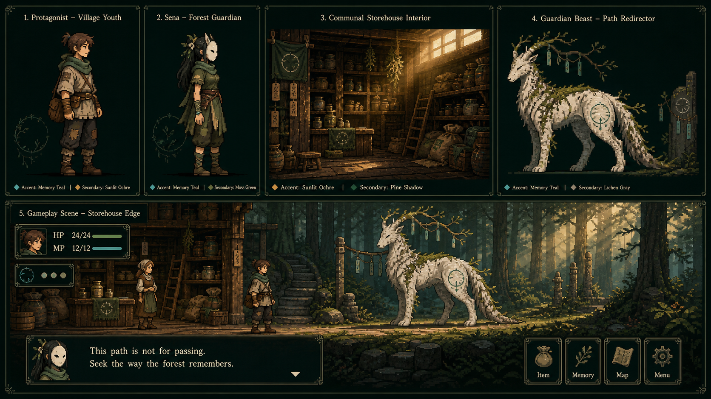
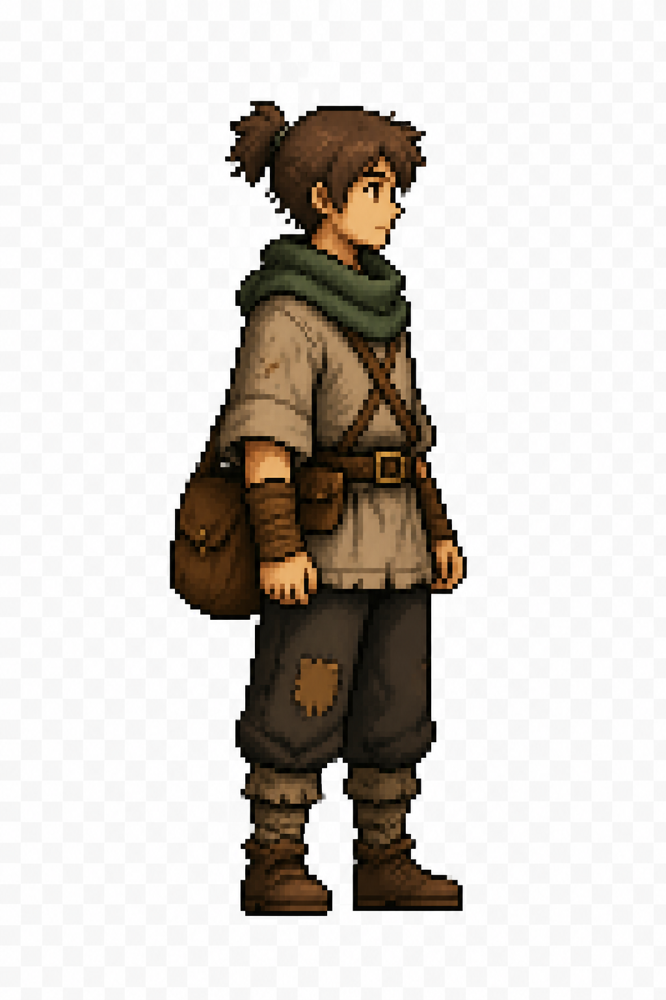

# 『余白の森』アートバイブル

> 対象：制作手順書 Phase 8  
> 状態：背景質感・主人公・白樹の獣の方向承認／v26人物・v28共同倉・v31村道・v33村門・v35境界・v37涸れ沢・v39罠の道・v41落ちた橋・v45狩人の野営地・v47守護樹の窪地・v49根洞窟入口・v51反響回廊・v53守護樹心部・v55深い森・v57結び木・v59遺跡前を本番採用  
> 更新日：2026-09-24

## 0. 役割

本書は、完成版の背景、フィールド人物、立ち絵、敵を同じ作品に見せるための量産規約である。
世界観とシステムは`シリーズ設定書.md`と`余白の森_設計書.md`、色の実装値は`src/core/palette.ts`と`src/core/theme.ts`を優先する。

第一作の`アートバイブル.md`は制作上の教訓として参照するが、燭台、書庫、四方向歩行、第一作の16色表は本作へ流用しない。

> **第一作が「火に照らされた紙」なら、第二作は「木漏れ日に透ける記憶」。**

「現代感」は写実化や高解像度化ではなく、情報の階層、自然光の色相差、接地、滑らかな画面遷移で出す。

『Phoenotopia: Awakening』のような、横画面の中に生活、地形、色、物語の気配が同居する密度を方向上の参考とする。
固有の人物、画面構図、配色、UI、意匠を写すのではなく、温かい色、遠中近景の奥行き、歩いてみたくなる土地の手触りを本作固有の村・森・遺跡へ翻訳する。

## 1. 量産前に凍結する見た目

### 1.1 画面とドット

| 項目 | 基準 |
|---|---|
| 内部座標 | 480×270 |
| 実描画 | 960×540 |
| 拡大 | 整数倍、補間なし |
| 背景完成原寸 | 960×540。Canvasでは480×270として表示 |
| フィールド成人 | 原寸64×96、表示32×48 |
| フィールド子供 | 原寸56×80、表示28×40 |
| 立ち絵 | 原寸128×128、表示64×64 |
| 戦闘敵 | 原寸170×170以内、下辺中央アンカー |

斜めの輪郭を滑らかにするアンチエイリアスは使わない。半透明は霧、光、粒子、UI面に限り、人物輪郭の補間には使わない。

### 1.2 頭身と輪郭

- 成人は約4.5頭身。写実寄りの6〜7頭身にも、3頭身以下のちびキャラにも寄せない。
- 子供は約4頭身。成人版と同じ目、鼻、髪の塊を残し、頭だけ大きくして別人にしない。
- 顔は実表示で横6〜8pxを目安にし、目は1pxの点または2pxの短線まで。
- 外輪郭は実表示1px相当。全周を黒で囲わず、暗側、靴底、小物の境だけを締める。
- 胴、脚、靴の三つが実表示で読めること。長衣で脚と足元を隠さない。
- 足元は全人物で同じYへ置き、接地影で地面との距離を示す。

v22更新：主人公は承認済みのv20の細身体型と茶髪を制作基準とし、頭身の数値だけを理由に体格を再変更しない。v21の水色案はユーザーが不採用を選び、元の茶髪へ戻した。以下のv21節は制作履歴であり、現在の髪色指定ではない。

判断は単体の見栄えではなく、主人公、セナ、狩人頭、管理人を同じ足元へ並べて行う。

## 2. サイドビュー人物規約

### 2.1 基本方向

- 完成素材は右向き一系統を基準とし、通常の左向きは描画時反転で作る。
- 上向き、下向き、背面、斜め歩行は作らない。
- 待機2コマ、歩行4コマを主人公とセナの上限基準とする。
- NPCは待機1〜2コマ。画面上を実際に歩く者だけ歩行を作る。
- 待機は歩行0コマ目と同じ身長、頭、足元から作り、立ち止まった瞬間に縮ませない。

この方式により、キャラクター生成で必要な方向数を一方向へ絞る。生成回数を増やすのは、左右非対称が物語上の意味を持つ場合だけとする。

### 2.2 セナの反転禁止要素

セナの左利き、左手、指輪は手掛かりなので、通常スプライトと同じ反転を掛けない。

- 身体、衣服、仮面は通常反転できる基礎レイヤー。
- 左手、指輪、罠を切る手は非反転の上乗せレイヤー。
- 「指輪を見せる」「左手で切る」は専用ポーズを左右別に持てる。
- 指輪は常時大きく発光させない。読み取らせる場面だけ1〜2pxの青緑と短い金属反射を置く。

### 2.3 動き

- 歩行の頭頂上下は実表示2px以内、足元の上下は1px以内。
- 待機は呼吸による胴の1px変化まで。全身を浮かせない。
- 会話感情を歩行差分で量産しない。姿勢、立ち絵、台詞、間で表す。
- フィールド敵は静止画を基本にし、呼吸1〜2px、発光、揺れ、ヒットをコードで加える。

## 3. パレット

### 3.1 共通UI色

実装の正は`src/core/palette.ts`。アセット側がUI文字色を流用して画面全体を白くしない。

| 役割 | 色 |
|---|---|
| 画面外・最暗部 | `#071411` |
| UI主面 | `#10231e` |
| 選択・見出し面 | `#183129` |
| 本文 | `#edf3e7` |
| 補助 | `#afc2b8` |
| 主強調・木漏れ日 | `#dfbd69` |
| 指輪・記憶・魔力 | `#72d6c0` |
| 危険 | `#f08070` |
| 忘却・余白 | `#b9a9e6` |

本文色、補助色、操作ヒント色、枠線色の用途を入れ替えない。

### 3.2 場所色

| 場所 | 暗部 | 中間 | 明部 | 差し色 |
|---|---|---|---|---|
| 村 | 深い松葉、濡れた土 | 苔、木、藁 | 朝霧、乾いた土 | 若い金 |
| 浅い森 | 湿った樹皮 | 若葉、青緑 | 空の水色、葉裏 | 木漏れ日の金 |
| 深い森 | 藍、深緑 | 青緑、菌糸 | 霧、胞子 | 冷たい青緑 |
| 遺跡 | 濃藍、黒曜 | 群青、青緑、古い金属 | 月白、鮮やかな冷光 | 菫と古金 |
| 最奥 | 遺跡色から彩度を引く | 青灰 | 象牙 | 指輪の青緑だけ |

一画面の主差し色は一つ、補助差し色は一つまで。金、青緑、菫、珊瑚を同じ強さで同時に出さない。

### 3.3 景観の鮮やかさ（2026-09-24追加）

- 深い森v55と結び木v57は現在の採用状態を維持し、遡って一律に彩度を上げない。遺跡前v59から新基準を適用する。
- 「落ち着いた世界観」を、全域が同じ低彩度の緑・灰・茶になることと混同しない。暗部は濃く保ち、中間色の青緑・群青と、古金・菫の焦点を一段鮮やかにする。
- 美しさは小さな発光点だけで補わない。各画面に、色と光がまとまって見える中規模の焦点面を一つ置く。人物の背後は読みやすさを優先し、焦点面とは離す。
- 全体へ同じ彩度補正を掛けず、冷たい影、彩度のある中間色、温かい反射の距離で豊かさを作る。苔色と土色だけで画面の大半を占める候補は採用しない。
- 遺跡編は森パレット138色へ強制写像しない。`ruin_approach` v59で新設した192色の地域パレットを基準に、群青・青緑・菫・古金の役割を後続遺跡背景へ引き継ぐ。
- 960×540と480×270の双方で、色面の差が残ることを確認する。縮小やパレット化で鮮やかな焦点が濁った場合は、色数を減らすことより景観の魅力を優先して変換規則を見直す。

### 3.4 明暗段階

- 人物と敵は、輪郭／影／中間／明部／一点ハイライトの最大5段を目安にする。
- 背景は人物よりコントラストを一段下げる。
- 前景の最暗部は画面端へ寄せ、主人公の顔と会話窓の裏へ固い黒を置かない。
- 忘却は白ノイズを足さず、彩度と環境音を引く。完全な無彩色はCALL直前まで温存する。

## 4. 光源と接地

- 村は右上の朝日。屋内共同倉は入口から斜めに入る同じ朝日を使う。
- 浅い森は上方の面光源。葉の隙間だけ金の小斑を置く。
- 深い森は上の自然光を弱め、下層の胞子と湿気を補助光にする。
- 遺跡は上方または奥からの彩度を残した冷光。古い金属と欠けた縁には、冷光と明確に離れた古金の暖色反射を持たせる。
- 最奥は背後の環から青緑の逆光。顔を完全なシルエットにしない。
- 接地影は人物の足元に横長、実表示1〜2px。光源方向と無関係な丸い影を置かない。
- ブルームは背景光と指輪の瞬間演出だけ。文字、顔、輪郭へ恒常的に掛けない。

## 5. 背景規約

各固定画面は遠景、中景、前景、粒子・環境光の四層で考える。

### 遠景

空、山、森影、壁面。隣接パネルで水平線と大きな樹列をつなぎ、画面切替後に別の土地へ飛んだように見せない。

### 中景

建物、木、遺跡、調査対象。各パネルで一つだけ固有の読み取り対象を置き、会話の場所を見失わせない。

### 前景

葉、梁、柱、霧、影。画面左右へ寄せ、主人公の移動帯と会話本文を恒常的に隠さない。

### 場所ごとの密度

- 村：生活物は少ないが、空の棚、補修跡、使い回した縄で困窮を見せる。廃村にはしない。
- 浅い森：足元を読みやすくし、枝葉は上半分へ寄せる。
- 深い森：前景を増やす代わりに、移動帯へ霧の抜けを作る。
- 遺跡：装飾を全面へ敷かず、校訂印、欠損、円環など物語に必要な形だけを反復する。
- 最奥：情報量を減らし、欠けた環と二人の距離を主役にする。

### 描画密度とイラスト感

- 基準は白い木の境v35。背景は大きな色面、明確な輪郭、2〜4段階程度の陰影で材質を伝える。
- 葉、樹皮、土、石を粒状のハイライトや均一な細密描写で埋めない。小さな人物より背景の微細模様が先に見える状態は不合格。
- 奥へ進むほど暗さと形の古さは増やしてよいが、写実度やノイズ量は増やさない。神秘性はシルエット、色温度、余白で作る。
- 生成原本が写真加工のように見える場合、構図を維持した一度の描画密度調整を比較する。改善しなければコード版または先行候補を維持し、細密化を量産しない。

## 6. 立ち絵

- フィールド全身を先に合格させ、その顔立ちから128×128原寸（表示64×64）の立ち絵を作る。コード描画では表示64×64の座標へ直接描く。
- 胸像から全身を逆生成しない。頭が大きくなり、フィールド頭身とずれるため。
- 顔の向きは3/4を基本とし、視線が会話本文の外へ逃げない。
- 表情差分は主人公、セナ、狩人頭を優先。通常NPCは1枚で姿勢と話者色を使う。
- 服の材質、補修跡、役割を一つずつ読ませ、小物は一人一つまで。
- セナの仮面差分は同じ顎、首、肩幅を保ち、仮面を外した瞬間に別人へ変えない。

## 7. 敵

- 魔物は侵入者を食べる形より、押し返す、塞ぐ、囲う、道を変えるシルエットを優先する。
- 植物、角、根、羽、石像のどれか一つを主形状とし、全部を混ぜない。
- 戦闘静止画は下辺中央アンカー。接地面を透過余白の中へ埋めない。
- 通常敵は1枚を基本にする。根の番人、名のない唱和、セナCALLに各1差分を許可する。導入戦の白樹の獣は、道を譲る姿をコードで維持するか、同じ個体の姿勢差分1枚として用意する。
- 血、腐敗、牙の強調ではなく、守護域の規則と誤作動を形で示す。
- フィールドシルエットと戦闘絵は、角、枝、頭部など最低一つの識別形を共有する。

## 8. 忘却と指輪の演出

### 忘却

1. 周囲の彩度を落とす。
2. 環境音の一層を消す。
3. UI候補と呪文帳だけを隠す。
4. 名前を示す空白の字幅は残す。

砂嵐、画面割れ、赤い警告、長いグリッチを足さない。忘却は「何かが増える」のではなく「そこにあった層が引かれる」演出にする。

### 指輪

- 平常時は青緑1〜2pxと古い金属色。
- 反応は欠けた円が一度脈動し、短い金属音が鳴る。
- 万能バリアの球体、常時オーラ、虹色の発光にしない。
- CALL正答時は爆発光を使わず、左手が下がる動きと環境色の回復を決着にする。

## 9. UIと画面演出

- UIは背景より一段暗い松葉色。1px影と上辺1pxの反射で面の高さを示す。
- 選択中は矢印、面、縁の三つで示し、色だけに頼らない。
- HP、MP、状態異常はフィールドと戦闘で位置関係と色を揃える。
- 操作ヒントは右下。会話本文や目的文と同じ段へ置かない。
- 会話窓は上下へ滑らせず、2〜3フレームの明度変化で開く。
- 戦闘開始は周辺の彩度を引き、敵へ焦点を集める。長い黒フェードを使わない。
- 被弾は短い停止、1px揺れ、輪郭光。大きな画面シェイクはボスでも常用しない。

## 10. 制作工程

### 10.1 制作分担

シリーズ設定書14.10と本作設計書11.6に従う。目標は「人物はシンプルで読みやすく、背景は色彩と生活感が豊か」である。
次の表は置換方針であり、生成・採用が済んだという記録ではない。実施状態は`余白の森_資産台帳.md`を正とする。

| 区分 | PixelLabで試す範囲 | 残す基準・コード層 | 採用の判断 |
|---|---|---|---|
| 背景 | 森、建物、石、草花などの静的な材質と遠・中・近景 | 構図、歩行帯、出入口、光、霧、時間差・状態差の制御 | 人物と文字が読め、隣接画面と同じ土地に見えること |
| フィールド人物 | 成人主人公の右向き静止画から比較。合格後にセナと動き | 現行の簡略な輪郭、頭身、衣装の識別記号、パレット、足元。左手と指輪の別制御 | 生成版かコード版かを人物カテゴリとして決める。コード版の完成採用も可 |
| 会話肖像・挿入画 | 合格した人物を起点とする表情と一段詳しい材質 | フィールド姿との同一性、仮面前後の顔形、正確な手掛かり | 主要人物の現行コード肖像と実画面比較して決める |
| 敵 | 現行シルエットを起点とした戦闘画像。最初は白樹の獣 | 識別形、接地、呼吸、反応、非殺傷の姿勢変化 | フィールドと戦闘で同じ個体に見え、道を譲る決着を維持できること |
| 物語小物・文字 | 紙、木札、布などの文字を含まない材質のみ必要に応じて試す | SLANE・SENA・署名、二重結びの形、指輪の側、門の開閉、札や荷袋の増減 | 形と表示時機をコードで保証し、進行フラグと食い違わないこと |
| UI・光・粒子・遷移 | 生成対象にしない | フォント、窓、ゲージ、入力欄、霧、光、粒子、暗転、揺れ | 完成版でもコード描画を維持する |

背景へ人物、UI、読める文字、開閉する門、消える札を焼き込まない。
生成する静的な材質と、ゲーム進行・左右関係・演出を担う層を分ける。
既存コードを完成版として残すかは品質審査で決め、単に「現在動いている」ことを完成判定にしない。

### 10.2 生成へ移るタイミング

1. 村への報告から森入口までの構図、場所色、歩行帯、会話窓の余白を整える。
2. 森入口の通常画面と会話中の画面を同じ縮尺で確認し、生成用の構図参照にする。材質の細部まで全画面を作り込む必要はない。
3. PixelLabで少数の候補を作り、現行画面と比較する。生成開始時に接続、利用できるモデルと参照入力、出力寸法、透過、費用・利用条件を確認する。
4. 合格したカテゴリの制作方式を記録してから、共同倉、他人物、他地域へ展開する。全編の最終調整と新規保存からの手動通しは別に行う。

PixelLabを利用できない場合は構図参照・指示書の準備までとし、別の生成元へ無断で切り替えない。

### 10.3 最初の少数試作

これは制作対象の順序であり、各1回の生成で合格する保証や生成回数の予約ではない。

| 順序 | 対象 | 最初に確認すること |
|---|---|---|
| 1 | 森入口 `forest_edge` の背景1画面 | 若葉・水色・古金の色差、遠中近景、歩行帯と文字の抜け。人物・UI・可読文字なし |
| 2 | 白樹の獣1体 | 白い樹皮と枝角、横長の姿、下辺アンカー。静止画の合格後に道を譲る姿勢も確認 |
| 3 | 成人主人公の右向き静止画1体 | 現行コード版と同寸で並べ、髪、苔色の襟巻き、補修、肩掛け鞄が読めるか |
| 4 | セナの右向き静止画1体 | 主人公と同じ頭身・密度。左手と指輪を別制御できるか |
| 5 | 上記を会話窓・戦闘UIへ合成した比較画面 | 生成単体ではなくゲームとしての読みやすさと統一感 |

人物の静止画が合格した場合だけ、同じ姿を起点に待機2コマ・歩行4コマへ進む。
全フレームを同じCanvas・足元へそろえ、コード版を残す判断の場合も同じ動作比較を行う。
共同倉は初回の森背景と人物の比較後、暖かい生活空間へ展開できるかを確かめる次の背景とする。
v1の「主人公・セナ・共同倉・白樹の獣・UI」という比較記録は履歴として残し、現在の生成開始順は本節を正とする。

### 10.4 合格と展開

- 第12章の合格条件を確認し、現行コード版／PixelLab候補／同じUIを載せた合成を並べる。
- 原寸960×540と整数倍表示を確認する。PNGの格子模様を透過として扱わず、人物・敵・前景の必要部分に実際のアルファ透過があることを確かめる。
- 生成版が画風や動作に合わなければ、候補の修正かコード版の完成採用を判断する。寸法や頭身を変える場合は量産前に正本を更新する。
- 最初の代表比較はユーザーへ見せ、画風の方向が合うことを確認してから他地域・他人物の大量生成へ進む。
- 採用方式、モデル、参照画像、プロンプト、加工値、残すコード層を資産台帳へ記録する。同一カテゴリの本番表現を一体・一画面ごとに別の画風へ切り替えない。

展開時は、成人主人公／子供主人公／セナの人物板、村／浅い森／深い森／遺跡の背景板、通常敵とボスの敵板へ追加して再比較する。
初回試作前に全素材の制作を済ませるための比較板にはしない。

## 11. 命名と出力

本素材は第一作資産と混ぜず、次を基準にする。

```text
src/assets/series2/
  backgrounds/<panel-id>/{far,middle,foreground}.png
  sprites/<character-id>/{idle,walk,special}/...
  portraits/<character-id>/<expression>.png
  enemies/<enemy-id>/{field,battle,variant}.png
  inserts/<insert-id>.png
```

- 上記は採用後の保存規格。現時点で全フォルダ・画像が存在するという意味ではない。
- ID部分は既存データの小文字ASCIIとアンダースコアを維持し、追加差分名はハイフンで区切る。
- 同じアニメの全フレームは同一Canvas寸法。
- 加工前原本、加工後PNG、採用プロンプト、生成元を混同しない。
- 試作・比較・不採用原本は`docs/concepts/`側で管理し、採用画像だけを`src/assets/series2/`と`src/core/series2Assets.ts`へ登録する。
- 本番は`publicDir: false`のため`public/`へ新素材を置かない。Sceneへ固定URLを書かず、専用目録を入口にする。
- 採否・生成元・参照・加工・利用条件の確認記録は`余白の森_資産台帳.md`へ残す。第三者素材のライセンス原文は`第三者ライセンス.md`から追えるようにする。
- `verify:assets`はv19で実装。初採用の背景PNGの寸法・命名・ID・透過・参照・欠落を検査する。新カテゴリ採用時にはその規格を追加する。`build`と、採用画像の配布も確認する`verify:bundle`を併用する。

## 12. 代表5点の合格条件

- 主人公とセナが同じ作品、同じ年代、同じ縮尺に見える。
- 子供と成人で髪、目、顔の塊がつながって見える。
- 右向きと反転左向きで輪郭が破綻しない。
- セナの左手と指輪だけは反転後も設定どおりの側にある。
- 待機と歩行で身長差が実表示2px以内、足元差が1px以内。
- 背景三層が読め、人物のシルエットが沈まない。
- 会話29字、地の文35字、HP/MP、入力欄が背景上で読める。
- 960×540と整数倍拡大でドットが崩れない。
- 第一作より色域と自然光は豊かだが、シリーズ共通の文字、UI、入力体験を失っていない。

一項目でも不合格なら量産へ進まない。寸法や頭身を変える場合は、代表5点だけを直し、設計書と本書を更新してから再確認する。

## 13. 代表比較板 v1（2026-08-30）



この比較板は完成素材ではなく、色、密度、光、接地を決めるための方向確認用である。
画像生成の初稿をそのままゲームへ組み込まず、次の判断だけを採用する。

### 採用する方向

- 共同倉は物が少ない廃屋ではなく、補修しながら長く使われた生活空間にする。
- 村の金色と森の青緑を、画面内で競合させず場所の境界として使う。
- 白樹の獣は牙より白い樹皮、枝角、道を塞ぐ横長の姿勢を識別形にする。
- 人物は成人4.5頭身を守り、頭・胴・脚・靴を横画面でも読める大きさにする。
- UIは暗い松葉色の面、細い古金の縁、青緑の状態表示で世界へ馴染ませる。
- 背景は遠景の森、中景の道、前景の葉と石を分け、歩行帯へ明るい抜けを残す。

### 採用しない部分

- 比較板内の英字ラベル、英語台詞、アイコン列はゲーム素材に使わない。
- セナの左手と指輪は生成画像の曖昧な左右を採用せず、非反転レイヤーで描き直す。
- 背景の描き込み量をそのまま480×270へ縮小しない。人物の輪郭を沈ませない密度へ整理する。
- 写実寄りの木材陰影や細線を直接使わず、内部座標で読める3〜5段階へ減色する。

### 次の比較板で直すこと

1. 文字と番号を完全に除く。
2. 主人公とセナを同じ大きさ、同じ足元、同じ右向きで並べる。
3. セナの左手リングレイヤーを拡大枠で明示する。
4. 共同倉をゲームの480×270構図へ合わせ、会話窓を置く余白を確保する。
5. 白樹の獣をフィールド用と戦闘用の二つの縮尺で比較する。

### 主人公アンカー v1



衣服、補修跡、鞄、4.5頭身前後の輪郭を確認するための概念画。右向きと足元は合格。
ただし、画像生成結果の格子背景は実際のアルファ透過ではなく画像へ焼き込まれていた。
背景抽出を再試行しても透過画素が0だったため、完成スプライトには昇格させない。

- 採用：髪の塊、短い苔色の襟巻き、生成りの上衣、膝の大きな補修、肩掛け鞄。
- 要調整：外周の黒を減らす。腕と鞄の重なりを64×96で読める形へ単純化する。
- 制作条件：この概念画を直接縮小せず、64×96の透明Canvasへ輪郭から描き直す。
- 検査条件：PNGのアルファ最小値が0であること。格子模様を透明背景の代用にしない。

## 14. 簡略フィールド人物 v2（2026-08-30）

代表比較板v1の緻密な人物を直接縮小せず、実表示32×48以内で読めるコードネイティブな静止画へ翻訳した。
比較板v1は衣装、性格、光の資料として残し、フィールド上の線数と陰影量は引き継がない。

### 採用した分担

- 人物は輪郭と一人2〜3個の識別記号へ情報を絞る。
- 色彩密度は、空、木漏れ日、草花、布、小物、粒子を持つ背景側で作る。
- 人物の明暗は最大5段、外周を黒一色で囲わない。
- 立ち絵と重要な挿入画だけ、表情と材質をフィールド人物より一段詳しくする。

### 主人公

- 苔色の短い襟巻き。
- 生成りの短衣と斜めの鞄帯。
- 右膝の大きな補修布。
- 小さな横顔と髪の跳ねで進行方向を読む。

### セナ

- 長い黒緑の髪、細い青緑の上衣、白い仮面を識別形とする。
- 仮面を外しても髪、肩幅、上衣、足元を変えない。
- 左手と指輪は身体の左右反転から分離し、向きごとに明示的に描く。
- 指輪は錆びた金属1pxと青緑1px。通常時のオーラは付けない。

### 背景側の色彩

- 村門と浅い森の中間色を明るくし、暗部を黒でなく青緑へ寄せた。
- 金、珊瑚、若葉、青緑の草花を歩行帯の端へ数ピクセルだけ置く。
- 木漏れ日は大面積の半透明光として置き、人物へ細かな照り返しを描き込まない。
- 一画面の主差し色一つ、補助差し色一つという規則は維持する。

### 実画面確認

- 村門の明るい空と土の上で、主人公の顔、襟巻き、鞄、脚、靴が分離して見える。
- 最奥聖域で主人公と仮面のセナが同じ人間の縮尺に見える。
- セナを巨大なボスシルエットにせず、対話可能な一人として配置できる。
- 会話窓、目的窓、操作ヒントを重ねても人物の頭と足元を失わない。

このv2静止画をフィールド人物の基準とする。

### 主人公の待機・歩行 v3

- 待機は2コマ。0.72秒ごとに胸元の明部と襟巻きの尾だけを1px変える。
- 歩行は4コマ。移動距離12デザイン単位ごとに1コマ進める。
- キーを押し続けた場合は約6コマ／秒、単打移動では1回ごとに次のコマを表示する。
- 歩行の中間2コマは胴を1px上げ、脚を1px伸ばして靴底を同じYへ残す。
- 停止後0.12秒だけ最後の一歩を保ち、静止姿勢へ瞬間的に跳ばない。
- 腕は脚と逆位相で最大1px、襟巻きの尾も最大1pxだけ動かす。

村門の実画面で右歩行4コマ、左反転、停止後の待機復帰を確認した。
頭頂差は1px、靴底差は0pxで、鞄、膝の補修、顔の向きを全コマで維持している。
この速度と振幅を主人公の量産基準とし、次にセナの待機2コマ・歩行4コマへ展開する。

### セナの待機・歩行 v4

- 主人公と同じ待機2コマ・歩行4コマ・約6コマ／秒を使う。
- 歩幅と胴の上下は主人公以下に抑え、静かに道を塞ぐ人物像を維持する。
- 長髪は歩行の前後コマで左右へ最大1px、待機時は最大1pxだけ動かす。
- 青緑の上衣は胸元の明部だけを待機2コマで1px変える。
- 仮面と素顔は同じ頭頂、顎、肩幅、足元を共有する。
- 左手と指輪は反転する身体から分離し、各向き・各歩行コマへ個別に追従させる。
- 指輪側の手は歩行中も上下・前後とも最大1px。発光面積は1pxのまま増やさない。

開発メニューへ「人物　歩行比較」を追加した。この画面は進行保存を変更せず、
主人公とセナを同じ背景、足元線、フレーム番号で並べる。
ENTERで待機／歩行、左右キーで向き、Mで仮面の有無を切り替えられる。

実画面で仮面あり・なし、右向き・左向き、待機2コマ、歩行4コマを確認した。
セナの頭頂差は1px、靴底差は0px。左手と指輪は両方向で身体反転へ巻き込まれていない。
本編では最終聖域の仮面姿、CALL後のセナ、単一エンディングのセナへ待機2コマを接続する。
歩行4コマは帰路やシリーズ3の同行演出へ使える基準素材として保持する。

### 主要NPCの識別記号 v5

主人公・セナと同じ32×48以内、同じ足元線で、村の主要NPCを比較できる基準形へ整理した。
人物一人に大きな職業道具は一つまでとし、細部を増やす代わりに輪郭と配色で役割を読む。

- 管理人：生成りの前掛け、銀髪の結い目、腰の小さな鍵。待機2コマ。
- 村人：茶の頭布、短衣の継ぎ当て。専門職の大きな道具を持たず、待機1コマ。
- 狩人：深緑の頭巾、段差で描く弓、背中の矢筒。待機2コマ。
- 行商人：低い梅紫の帽子、紫の襟布、横へ張り出す大きな背負い荷。待機2コマ。

待機差分は手元、道具、明部だけを最大1px変え、靴底と人物の高さは固定する。
管理人・狩人・行商人は本編にも待機2コマを接続し、一般の村人は生活背景として静かに置く。
弓は曲線描画を使わず矩形の段差だけで構成し、ほかの人物と同じピクセル密度を保つ。

開発メニューの「人物　歩行比較」はTABで主役／NPCを切り替えられる。
NPC表示では4人を同じ背景、同じ足元、同じ向きで並べ、左右キーで反転、待機フレーム番号で2コマ差を確認する。
実画面で両方向と待機2コマを確認し、役割記号の欠落、ラベルの重なり、足元のずれ、ブラウザ警告がないことを確認した。

### 敵シルエット比較 v6

通常敵3体と主要ボス3体を、同じ森背景、同じ下辺アンカー、同じUI内で比較できる基準板へ整理した。
フィールドと戦闘で同じ識別形を使い、呼吸は描画側の上下動だけに留める。

#### 通常敵

- 苔背の狼：低い胴、水平な尾、背中から生える苔の三つを主形状とする。
- ささやき蛾：左右へ広い二枚の翼、細い胴、青緑の囁き粉を主形状とする。
- 封印衛：直立する石の肩、頭より大きな胸の校訂印、左右の脚柱を主形状とする。

通常敵は、低い獣／浮く翼／直立する人工物という三種類の高さと接地を持つ。
色を外しても種別が重ならず、一体につき主形状を一つへ絞る。

#### 主要ボス

- 根の番人：人型の巨木ではなく、根が一時的に門を作った横広の形。腕と根を左右へ伸ばす。
- 名のない唱和：五体の敵ではなく、高さの違う五つの記録が一枚の壁を作る形。青緑の縦線で声の連結を示す。
- 仮面の守人：人物板と同じ人間の縮尺、仮面、長髪、左手の指輪。ボス用に巨大化しない。

ボスは横幅、高さ、複数性のいずれかを通常敵より一段強くする。
ただし仮面の守人セナだけは、人間の小ささそのものを他のボスとの差として使う。
これにより最終戦を「巨大な怪物の討伐」ではなく「一人の名前を呼び戻す対話」として扱う。

白樹の獣は正式なボス数へ含めず、導入の境界障壁として別枠で基準化する。
横長の姿勢、白い樹皮、左右で高さの違う枝角を使い、牙を識別形にしない。

開発メニューへ「敵　シルエット比較」を追加した。
TABまたは左右キーで通常敵3体／ボス3体を切り替え、ENTERで呼吸を止めて純粋な輪郭を確認できる。
実画面でラベルとの干渉、下辺のずれ、ボス同士の識別、背景への沈み込みがなく、ブラウザ警告がないことを確認した。

### 全敵への展開 v7

v6の代表6体で決めた「一体につき主形状一つ」「矩形の段差」「同じ下辺アンカー」を、残りの通常敵と稽古台へ展開した。

- 罠喰い蔓：中央の結び目と、四方向へ道を縫う直角の蔓。曲線描画を使わない。
- 洞角猪：重く低い胴と、樹洞の輪を持つ大きな鼻面。
- 白枝鹿：細い脚と縦へ伸びる白い枝角。白樹の獣より軽い姿勢。
- 名喰い蛭：欠けた名札を紫の段差でつないだ這う形。滑らかな蛇状曲線を使わない。
- 空筆の像：白紙の顔、頁の重なる裾、身体より長い一本の空筆。
- 反響標：生物の手足を持たず、反響板、支柱、固定土台だけで構成する。

敵比較画面は次の4群、合計12体へ拡張した。

1. 浅い森：苔背の狼／罠喰い蔓／ささやき蛾
2. 深い森：洞角猪／白枝鹿／名喰い蛭
3. 遺跡：封印衛／空筆の像／反響標
4. ボス：根の番人／名のない唱和／仮面の守人

TABまたは左右キーで4群を切り替え、数字キー1〜3でその位置の敵を実際の戦闘画面へ出せる。
実戦闘では本番と同じ背景、敵名、HP、入力窓、プレイヤーHUD、呼吸、発光を使い、ESCまたはF2で比較板へ戻る。
この導線は開発ビルドだけに存在し、進行保存、経験値、所持品を変更しない。

浅い森、深い森、遺跡の全比較板と、名喰い蛭の森戦闘、空筆の像の遺跡戦闘を実画面で確認した。
全敵の接地、敵名とHPの余白、入力窓との距離、暗部での輪郭、復帰操作に問題がなく、ブラウザ警告は0件だった。

### 4地域の背景比較 v8

村、浅い森、深い森、遺跡を、同じ主人公、同じ足元、同じ目的UIで比較する2×2背景板を追加した。
鮮やかさは人物の色数ではなく、空、遠景、中景、歩行帯、前景の層差と小さな生活色で作る。

#### 村

- 空は明るい青緑、丘は乾いた若葉、道は温かい土色に分ける。
- 家へ補修した布、窓、植木箱を置き、貧しさを無彩色や廃墟として描かない。
- 赤、金、青緑の布は小面積で反復し、建物一棟を派手な色へ塗らない。

#### 浅い森

- 遠い樹冠を青緑、若葉、金の三段にし、幹だけが並ぶ暗い森にしない。
- 木漏れ日は細い光線ではなく、大きな半透明の面を二つまで使う。
- 花とシダは左右端へ寄せ、中央の歩行帯と人物の靴を塞がない。

#### 深い森

- 空の上端を藍、中央を青緑、足元を苔色へ変え、暗さの中にも色相差を残す。
- 紫の記憶色は根の隙間と菌糸だけに使い、大面積の魔法オーラにしない。
- 白い根と結び目の古金を、進路と物語の識別形として残す。

#### 遺跡

- 石壁を黒や一様な灰ではなく、濃藍から群青・青緑へ色相が移る勾配にする。
- 王国以前の古金と、現在も動く鮮やかな青緑の校訂光を規則的に離して置く。菫は欠損や記憶の痕跡だけへ絞る。
- 植物の庭でも石壁の直線規格を崩さず、森と同じ場所に見せない。
- 遺跡前の最初の一画面で地域別パレットを確立し、以後は暗くする場合も色相差まで失わない。

開発メニューへ「背景　4地域比較」を追加した。
一覧は4地域を同時に2×2で表示し、数字キー1〜4で960×540相当の原寸表示へ入る。
原寸表示では左右キーで地域を送り、TABまたはESCで4面一覧へ戻る。
一覧と全4地域の原寸表示を確認し、人物、目的文、操作ヒント、足元の可読性と地域差に問題がなく、ブラウザ警告は0件だった。

### 共通UIの質感 v9

タイトル、会話、探索HUD、一時停止、戦闘の面構成を、同じ松葉色と1px規則へ統一した。

- 標準窓は暗い松葉色の面、青緑の枠、内側上辺の反射、右下の接地影を共有する。
- 左上だけ短い枠の節を置き、四隅を大きな金具や角丸で飾らない。
- 選択面は青緑2pxの左標、内側1pxの反射、右下の古金2pxを共有する。
- 選択は面、左標、記号の三つで示し、色だけに頼らない。
- 探索HUDのLEVELは小さな札へ収め、HP／MPとの間を1px罫線で分ける。
- 会話名札は話者色の左標を持ち、長い会話には上端の小さな頁節を表示する。
- 頁節は最大8個、現在頁だけ5px。他の節は3pxとし、本文より目立たせない。
- 戦闘コマンドと道具欄も共通の選択面を使い、入力窓と一時停止で操作感を変えない。

タイトル、探索HUD、一時停止、通常戦闘コマンドを実画面で確認した。
文字領域の縮小、行の衝突、背景への沈み込み、装飾の過剰はなく、ブラウザ警告は0件だった。

### 主要人物の会話肖像 v10

フィールド人物の簡略ドットを起点に、主人公、セナ、狩人頭、行商人の会話用64×64肖像をコード描画で作成した。
外部の高精細な顔絵へ切り替えず、フィールド姿と同じ色、髪の塊、衣服、小物を一段だけ拡大する。

#### 共通規格

- 原寸128×128、会話窓では64×64表示。Canvasの整数倍拡大だけを使い、補間しない。
- 顔は三分の二正面を基準とし、輪郭、目、鼻、口、髪を矩形の段差だけで描く。
- 肌、髪、衣服を含む人物の明暗は各材質3〜5段まで。細い描線や写真風の陰影を増やさない。
- 背景には話者固有色を置き、全員に森の青緑と木漏れ日の金を小面積だけ共有させる。
- 一人につき、フィールド姿と共通する識別記号を二つ以上残す。
- 名前のない地の文、一般村人、共同倉の管理人、若い狩人には肖像を出さず、重要人物との情報差を保つ。

#### 人物別の識別記号

- 主人公：暗褐色の髪、苔色の襟巻き、生成りの上衣、茶の肩帯。穏やかだが落ち着かない視線。
- セナ：黒緑の長髪、青緑の細い上衣、左手の指輪。素顔と仮面で頭、顎、首、肩幅を変えない。
- 狩人頭：深緑の頭巾、日に焼けた頬、革の矢筒。悪役の鋭い目ではなく、疲れた実務者の表情にする。
- 行商人：低い梅紫の帽子、紫の襟、金色の荷紐。村人より温かい土色と横幅を使う。

セナの左手は肖像でも別レイヤー相当として右下へ置き、指輪は古い金属色と青緑の反射2pxだけに留める。
仮面は石灰色の面、目の穴、右頬の欠けで構成し、巨大な発光や別の顔形を与えない。

シリーズ2の会話データでは、表示名 `{NAME}`、`セナ`、`仮面の守人`、`狩人頭`、`行商人` を肖像IDへ接続する。
この接続はサイドビュー本編だけに置き、シリーズ1の画像肖像経路を変更しない。

開発メニューの「人物　歩行比較」はTABで主役／NPC／肖像を切り替えられる。
肖像表示では4人を同じ64×64枠へ並べ、Mキーでセナの仮面あり／なしを比較する。
比較板と村門の本編会話で、4人の判別、仮面前後の同一性、三行本文の幅、名前札との重なりを確認した。
狩人頭から主人公へ話者を切り替えても文字領域と頁表示に問題はなく、ブラウザ警告は0件だった。

### SENA後の終戦演出 v11

最終戦のCALLでSENAが完全一致したあと、戦闘結果から素顔の探索人物へ瞬間的に切り替えず、最奥聖域に短い終戦演出を挟む。
これは撃破ムービーではなく、戦闘と「記憶が、戻ったの？」の会話を同じ場所でつなぐ継ぎ目とする。

- 背景は本編の最奥聖域と同じ `sanctum` を使い、専用の別背景を作らない。
- 主人公は画面右寄りの310、セナは405、足元は本編と同じ176へ固定する。
- 開始時は青灰色の薄い面を重ね、約2.1秒で通常の遺跡色へ戻す。
- セナの左手は反転させず、約1.25秒かけて3pxだけ下げる。大きな降伏ポーズにはしない。
- 仮面はCALLから1.05秒後に外れ、最大9px下がりながら消える。破砕はせず、小片は二つまで。
- 仮面のひびは1pxの段差だけ。爆発、白フラッシュ、画面振動、勝利ファンファーレを使わない。
- 指輪の反応は欠けた円弧二本と2pxの反射。一度だけ広がり、常時オーラを残さない。
- 2.8秒以降にENTERを表示し、プレイヤーが静止画を見届けてから先へ進める。
- 2.8秒より前のENTERは演出を停止点まで送るだけで、二度目の決定で本編へ戻す。

本編復帰時は `sena_called` を持つ最奥聖域へ戻り、目的を「セナに話す」とする。
仮面の守人は出現せず、素顔のセナが同じ場所に立つ。
開発メニューの「終戦　仮面を外す」から、演出、探索復帰、素顔肖像の「記憶が、戻ったの？」まで連続確認できる。

開始、仮面移動、素顔、ENTER停止点、本編復帰、会話肖像を実画面で確認した。
足元、左右関係、指輪の側、肖像との同一性、会話窓との切り替えに問題はなく、ブラウザ警告は0件だった。

### 単一エンディングの実景化 v12

単一エンディングは文字だけの暗背景をやめ、本編で歩いた場所と人物を使う3枚の実景へ統一した。
分岐一覧、達成率、別結末の鍵は追加せず、共同倉で閉じる本作の結末と、遠い王国へ向く次作の問いだけを残す。

#### 1枚目：共同倉

- 第一章と同じ共同倉、同じ棚、同じ足元176を使う。
- 主人公とセナを中央へ向かい合わせ、二人分の配給袋を本人の前へ置く。
- 壁には主人公とSENAの札を並べ、十年前の空白が視覚的に埋まったことを示す。
- 採取路から届いた最初の樹脂瓶を13×14以内で置き、村が突然豊かになったようには見せない。
- 台詞は従来どおり「一袋多かった配給」を正とし、演出追加で結末の意味を変えない。

#### 2枚目：夕暮れの村道

- 本編の村道背景へ夕方の青紫と古金を薄く重ね、別の美しい村へ取り替えない。
- 森側にあたる画面右から、共同倉側の左へ主人公とセナが約2.9秒で歩く。
- 主人公を先、セナを半歩後ろに置く。二人とも本編の歩行4コマを再利用する。
- 題字「余白の森」と「記憶は、すべて戻らなかった」を空の暗部へ置き、家並みと人物を隠さない。
- 「それでも二人は、もう一度友人になった」だけを指輪と同じ青緑で示す。

#### 3枚目：王国へ続く道

- 画面左を余白の森、右奥を王国、中央から右へ伸びる土の道を両者の接続にする。
- 一本道は遠景で細く、手前で広くする。矢印、地名札、世界地図で説明しない。
- 王国は人物より小さい遠景とし、塔二本と菫色の校訂光だけを識別形にする。
- 主人公とセナは手前で同じ右方向を向く。次作の衣装や武器を先行して与えない。
- 画面内に「シリーズ3へ」「つづく」などの予告文は置かない。道と王国だけで先を予感させ、本作の余韻を閉じる。
- 「すべての人へ渡すには？」だけを古金で強調し、シリーズ3の目的を問いとして残す。

各頁には最低表示時間を設定する。共同倉1.5秒、村道3.4秒、王国への道2.0秒とする。村道は2.9秒の移動後、歩行4コマ目まで踏み切って待機へ戻る時間を含む。
最低時間より前のENTERは停止点へ送るだけで、次のENTERで頁を進める。
頁切り替えには0.42秒の暗転明度を使い、横スライドや長い動画遷移を追加しない。

3頁すべてとタイトル復帰を実画面で確認した。
本文、題字、操作表示、人物、配給袋、樹脂瓶、遠景の王国に重なりはなく、ブラウザ警告は0件だった。

### 十年前プロローグの実景化 v13

十年前の導入は物語と台詞を増やさず、「同じ村」「名を刻む行為」「二重輪を結ぶ手」の三点を実景として補強した。
終盤でSENAを呼ぶための答えを強調するのではなく、幼い二人の日常動作として記憶へ残す。

#### 時間と場所

- 冒頭の「十年前」は抽象的な森影ではなく、十年後にも使う村道の家並み、井戸、道を暗い過去色で見せる。
- 王都の火、禁書、事件映像は出さない。村の灯り二点だけを残し、王都からの距離を生活景で示す。
- 十年前と十年後で共同倉の棚、中央掲示板、札の位置、人物の足元176を変えない。
- 十年後は同じ画角に成人した主人公、管理人、二袋を置き、説明なしでも時間経過と欠落を比較できるようにする。

#### 名前を刻む画面

- 名前入力は共同倉の木の作業台上に置く。梁、細い朝光、鑿、削り屑を加え、設定フォームではなく彫刻作業として見せる。
- SENAの札と主人公の札は同寸、同じ物資記載、同じ吊り位置とし、重要度の差を付けない。
- この時点では二枚を結び終えない。結び方は次の操作で初めてセナが見せる。

#### 二重輪の手元演出

- ENTER後、二枚の札を左右から8pxずつ近づける。
- 二本の紐を中央へ寄せ、青緑の袖と手を約0.9秒だけ画面上から入れる。
- 結び目は左右に同じ大きさの輪を残し、約1.2秒で完成する。完成前に会話を重ねない。
- 手が引いたあとも完成した結び目を画面中央に残し、その状態で「二枚一組なら、こう結ぶ」を始める。
- 派手な発光、拡大、成功表示は使わない。後半で反復できる形そのものを記憶させる。

#### 子どもの動き

- 主人公の移動は静止画の水平移動をやめ、左右の脚が入れ替わる4コマ歩行にする。
- セナの待機は長髪、細い上衣、左手の指輪を成人姿と共有する。
- 森から戻る二人は同じ速さ、同じ左向きの歩行とし、別れを予告する芝居を追加しない。

新規開始から、村景観、名前入力、共同倉、結び目、白い木、SLANE、帰路、十年後、第一章カードまで実画面で連続確認した。
「この指輪が少し温かくなる」を含む正典台詞、左右関係、文字領域、操作表示に問題はなかった。

### 第一章序盤の状態景 v14

第一章の共同倉、村道、村門、森の境界は、フラグが進んでも同じ背景のままにせず、会話で生じた状態を小物として画面へ残す。
新しい説明台詞や章内イベントは加えず、既存の往復導線を視覚的な因果へ変える。

#### 村道

- 最初に通る時点では行商人も荷車も置かない。薪割りの青年、低い共同井戸、補修布だけで村の日常を見せる。
- 狩人頭から森の異変を聞いた後、画面右端へ行商人と荷車を同時に出す。人物だけが突然出現したように見せない。
- 荷車は低い木箱、巻物箱、紫の包み、二輪で構成する。人物肖像と同じ梅紫と古金を小面積で反復する。
- 書庫火災の日付を聞いた後だけ荷台の記録紙を開き、細い記録線と菫色の印を残す。
- 記録紙へ数字や王国名を大書きせず、詳しい情報は従来の会話に任せる。

#### 村門

- 森の異変を聞く前から、門のそばへ空の狩具箱と矢を置く。背景NPCを増やさず、戻らない狩人の人数を空いた装備で示す。
- 最初の訪問では二本の横木と中央の二重輪で門を閉じる。データ上の通行止めと背景を一致させる。
- 異変を聞いた後は右柱へ赤茶の警告布を一枚だけ結ぶ。村門で最も強い暖色はここに限定する。
- 境界確認を頼まれた後は横木を村側へ外し、門の開口部から白い木が見える状態にする。
- 横木は消去せず地面へ立て掛け、誰かが開けた作業の痕跡を残す。

#### 森の境界

- 第一章の現在だけ、土の道へ五組の足跡と白い木直前の掻き跡を出す。十年前のプロローグには出さない。
- 足跡は右の森側へ1pxの爪先差を付け、矢印や発光線を使わず方向を示す。
- 白樹の獣、足跡、主人公の三者は同じ足元176へ置き、獣が村へ襲来した構図にはしない。

開発メニューへ「第一章　村道と村門」を追加し、配給報告後の村道から通常の往復を試せるようにした。
行商人到着前、閉じた門、警告後、荷車と行商人、日付判明後、開いた門、森側へ向く足跡まで実画面で連続確認した。

### 白樹の獣・非殺傷導入戦 v15

白樹の獣は倒す対象ではなく、境界を守り、最後に道を譲る相手として描く。
SLANE完全一致、他の呪文によるHP下限1、MP消費、再試行などの既存ルールは変えず、表示と姿勢を物語上の決着へ合わせた。

#### 同じ境界での対峙

- 戦闘背景にも白い幹と森側へ向かう足跡を残す。中央の密度は落とし、獣の枝角と背中の白い樹皮を読ませる。
- 開始文は白い木の前へ立つ獣と枝角を描写し、通常攻撃も「枝角で行く手を押し返した」とする。
- 相手のHP数値は出さず、青緑の「警戒」ゲージと「境界を守っている」を表示する。内部のHP計算は維持する。
- 主人公のHP、MP、攻撃、呪文帳は従来どおり表示し、試行の代価を隠さない。

#### 段階的な記憶救済

- SLANEの原場面は「十年前　白い木の境」とし、最終SENA入力の「十年前　共同倉」と分ける。
- 第一段階は二本の白い木、石摺り、五つの読めない線、小さな指輪の光だけを見せる。答えや署名は表示しない。
- 次の確認画面は「文字を含む記憶を、もう一度見る？」と場所を表示する。初期選択は「戻る」とする。
- 明示的に「思い返す」を選んだ後だけ、石摺りのSLANEと左側が低いSENA署名を見せる。紙の上のSLANEは原場面と同じ暗緑にする。
- 台詞の「声にすると、この指輪が少し温かくなる。」を維持し、ENTERで同じ入力欄へ戻す。

#### 道を譲る姿

- 成功後は前脚を折り、首と枝角を低く伏せる。背中の樹皮模様を残し、別の生き物に見せない。
- 呼吸と接地影は残す。消滅、横倒し、撃破の白い被弾フラッシュは使わない。
- NAMEの刻印演出を維持し、この決着では命中音・撃破音を鳴らさず、短い発見音へ置き換える。
- ゲージ下の文を「爪を収めた」に変え、決着は「道を譲った」とする。
- ENTER後は同じ森の境界へ戻る。獣は道から退き、探索HUDと村へ報告する目的が現れる。

森の境界から導入会話、専用戦闘、文字なしヒント、確認の取消し、文字付き記憶、SLANE手入力、姿勢変化、探索復帰まで実画面で連続確認した。
開始文、記憶の場所、紙面の文字色、決着文、HUDの解放に不整合はなかった。

### 帰村報告と森入口の代表構図 v16

第二章へ向かう出発を、村門の不在と森の足跡でつなぐ。
台詞、戦闘、経験値、進行条件は変更せず、生成へ渡す構図と静的・動的な層の境界を整えた。

#### 出発後の村門

- `chapter2_started` 後は、村門の狩具箱から矢と革袋がなくなり、空の箱だけが残る。
- 警告布、外した横木、白い木は残す。出発によって門が再び閉じたようには見せない。
- 開発メニューの「第二章　村門」も前段の会話フラグをそろえ、同じ場所に異なる段階の狩人頭が重複しないようにした。

#### 森入口

- 左には境界と同じ白い木、中央には淡い幹と青緑の空気、右には奥へ続く濃い森を置く。
- 足元176の歩行帯は水平につなぐ。枝葉と太い幹は上と左右へ寄せ、人物の頭から足までを読める状態にする。
- 遠景の樹冠は大きな段差付きの塊とし、その間に空を残す。明るい葉裏と端の草花へ暖色を限定する。
- 調査点x132付近に湿った土を置き、二列の靴跡とその周りを囲む獣の足跡を別描画する。
- 狼のx302と会話窓y182以降を維持する。狼は村側へ向き、背景の太い幹と顔が重ならない構図にする。

#### 生成用の参照

DEV背景比較の「浅い森」で、`C` による通常／文字なし／ガイド切り替えと、`S` による静的背景PNG書き出しを追加した。
参照は960×540。人物・敵・文字・ガイド・足跡・光芒・霧・粒子を含めず、背景の材質だけを試作できるようにする。
足跡は正確な位置で後から描き、環境演出もコードで維持する。
指示書は `docs/concepts/forest-edge-pixellab-brief-v1.md` を参照する。

通常導線の帰村報告、ZIROR習得、出発後の村門、森入口、足跡の会話を実画面で確認した。
これは代表構図の確認であり、全編手動通しや生成版の画風比較の完了ではない。
このv16時点では認証エラーで未生成だった。以降の状態は次のv17を正とする。

### 森入口のPixelLab試作と同条件比較 v17

再起動後に認証復旧を確認し、PixelLab Proで背景A/Bを生成した。各40枠、計80枠。原本は480×270・不透明で保存し、比較画面だけでnearestの整数2倍表示とする。
構図参照はコード版から書き出した960×540の静的PNG。初回は構図だけ、BではAの色・材質も参照した。人物・文字・足跡・光は生成対象にしない。

- 白樺、葉のまとまり、青緑の距離感は材質参考になる。中央の簡略人物と共通会話窓は読める。
- A/Bとも地面が足元y176より約40〜50px低く、人物・狼・足跡が浮く。下端にもAは7行、Bは5行の#fefffd帯がある。両方とも接地未合格。
- Bの文章による位置指定強化では直らなかった。構図参照・スタイル参照を渡すだけで座標が守られるとは扱わない。
- 追加生成を続けず、画風の方向を確認した上で、接地を固定する部分修正または樹林・地面の分割制作を検討する。足元やUIの規格を生成画像へ合わせて変更しない。
- DEVでコード/A/B、HUD/足跡会話/狼会話、主人公の3位置、光の有無、構図ガイドを切り替えられる。生成原本は本番Manifestへ入れない。
- 960×540と480×270相当の表示を確認。小ビューポート変更直後の撮影異常は反映後に撮り直し、中央の人物と会話文の可読性を確認した。構図修正後に再確認する。

出所、実送信プロンプト、参照、原本、画面記録、利用条件、次工程は `docs/concepts/forest-edge-pixellab-trial-v17.md`。
今回の試作は本素材投入の完了でも、全編手動通しの代替でもない。本番画像は0点のまま。

### 質感の承認と地面分離 v18

ユーザーがPixelLab背景の質感を承認した。白樺・葉の塊・青緑の遠景を本作の背景制作基準とする。
部分修正ツールはTier 2必須で失敗したため、A原本を保持し、新規生成の地面とゲーム内で重ねる方法を試した。契約変更や別サービスへの切替は行っていない。

- 配置C：森画像の表示を64px上へ寄せ、下端の明色帯は表示しない。地面480×128をy142へ置き、下端まで埋める。拡縮で幹・葉をつぶさない。
- 継ぎ目は足元より下の12行で透明度を変えてなじませる。規則的な網目が帯に見えた案は採用しない。
- 足跡の周辺は低密度な湿った土にし、跡は暗い茶色へ調整。靴跡・獣の足跡の数と位置は変えない。
- 960×540／480×270相当、人物の中央・左右、光なし、足跡・狼会話を確認。接地y176を保って地面に立つ構図になった。
- 上端64pxは画面外になるため、質感を維持しても構図はA原本と異なる。完全なパララックス三層素材ではなく、二枚合成の代表試作である。
- Sは生成用の静的構図、Eは人物・UIを含む合成記録として分離。元画像・表示加工・合成記録を取り違えない。

詳細は `docs/concepts/forest-edge-layered-trial-v18.md`。次は採用画像規格・専用Manifest・フォールバックを整え、通常の森入口で歩行→調査→遭遇を連続確認する。
現在はDEV比較だけで使い、本番画像は0点。全地域の量産・本素材投入完了にはしない。

### 森入口の正式採用 v19

- v18配置Cの静的な森林＋地面だけをM書出で960×540へ整数2倍化し、`backgrounds/forest_edge/middle.png`として採用した。原本と資料のPNGは配布しない。
- 人物・敵・足跡・光・霧・粒子・UIは焼き込まない。小さな土の面は静的景観、そこに載る靴跡・獣の足跡はコード層とする。
- この1点は固定画面用の合成済み中景であり、独立三層やパララックスの完成素材ではない。全地域をこの方式に固定しない。
- 本編の`forest_edge`だけで画像を表示し、読込失敗・未完了・不正寸法は従来の景観で継続する。その他の浅い森・境界・戦闘背景は変更しない。
- 探索中の苔背の狼は村側（左）へ向け、会話と一致させる。接地中心・姿形・戦闘側の向きと能力は変えない。
- 原本色、2×2ドットの一致、寸法、透過、目録の参照、正式PNGの配布を検査する。工程と実プレイ記録は `docs/concepts/forest-edge-adoption-v19.md`。
- 次の比較は採用背景上の白樹の獣・成人主人公。その後セナを合わせる。背景1点の採用を代表5点の完了に読み替えない。

### 主人公・白樹の獣の静止画試作 v20

- PixelLab Pixenで右向き静止画を各1枚生成し、各1回修正した。背景のProとは別の小型スプライト試作。原本4枚と実送信プロンプトを保存した。
- 主人公は苔色の襟巻き・生成りの服・小鞄・膝の補修、獣は白い樹皮・枝角・苔色の横長四足体型を持つ。生成初回に混入した台座と格子状の外周を、Pixen編集で除いた。
- 修正は本体の色も再描画した。原画素を完全に維持した局所的マスク編集ではない。前後を別原本として管理する。
- 32×48／80×64の原本をDEVで1px＝設計1pxとして表示。成人64×96／敵170×170以内の正式Canvas規格は維持する。採用用の整数2倍PNGは未作成。
- 主人公の本体18×42は原型より細身でやや少年寄りに見える。成人の体格・頭身を確認し、原型に合わせるための非整数拡縮はしない。
- 獣の本体71×60は原型より枝角が細かく鹿の印象が強い。白樹の境界を守る同一個体として、道を譲る姿勢でも枝角・樹皮・体型を維持できるか確認する。
- 明暗の単色面、採用森背景、左右反転、会話窓、戦闘配置、480×270相当の小表示を確認した。静止画候補として比較可能だが、歩行・待機・非殺傷姿勢は未生成。
- この代表比較をユーザーに示してから、体格調整・セナ・少数の動作差分へ進む。今回の候補を自動で本番採用せず、既存コード人物・敵の動作を維持する。
- 記録：`docs/concepts/character-pixen-trial-v20.md`。DEV入口は「人物 歩行比較」→G。本番画像はv19背景1点のまま。

### 主人公の水色髪と方向承認 v21

> 後続v22で水色案は不採用。ユーザー指定によりv20の茶髪を正とする。以下は当時の判断記録。

- ユーザーがv20の主人公・白樹の獣の方向を承認し、主人公の目立つ特徴を一任。水色の髪を選び、体格・衣装・獣の姿は承認された方向を継承した。
- 水色の髪、短い苔色の襟巻き、生成りの上衣、膝の補修、小鞄を主人公の識別要素とする。装飾や発光を増やさず、髪色に特殊能力・血筋の設定を結びつけない。
- v20主人公修正版をPixelLab Pixenで1回編集。原本は `hero-pixen-sky-v21.png`。透明背景・32×48・本体18×42・足元アンカーは維持。編集により髪以外の色も再描画されているため、厳密な色置換とは区別する。
- 青の影と明るい水色を組み合わせ、肌の暖色と襟巻きの苔色を残す。指輪の青緑を主人公の髪色へ流用しない。
- 本編の子供・成人・肖像のコード絵は `HERO_HAIR` へそろえる。旧記録の「暗褐色の髪」は履歴であり、以後の制作基準は水色。NPC・セナの色は維持する。
- 当時は主人公PNGと白樹の獣PNGをDEV比較で保持し、セナと獣の姿勢を次工程としていた。後続結果は下記v22節を正とする。
- 原本・プロンプト・費用・検査は `docs/concepts/hero-sky-direction-v21.md`。

### 茶髪への復元とセナの静止画 v22

- ユーザーは水色より元の色の組合せを選択。主人公は `hero-pixen-clean-v20.png` の茶髪・苔色の襟巻き・生成りの服へ戻す。体型を再設計せず、子供・成人・会話肖像のコード髪色も元に戻す。水色は不採用の制作履歴としてのみ残す。
- セナは主人公と同年代の男性。黒緑の長髪、青緑の細い上衣、茶色の帯と靴で描き分ける。素顔・仮面は同じ髪・肩・服のシルエットを起点とする。仮面を白いフードや鎧へ拡張しない。
- v22は静止画候補。Pixen編集は全画素固定ではなく、頭頂・靴底なども再描画される。足元補正による静止比較を、同一アンカーのアニメ完成と見なさない。指輪と左手の特別な動作は別層のまま、PNGへの接続は未実施。
- 白樹の獣の姿勢2案は不合格。頭と角が下がるだけで前脚が立ったままでは、道を譲る姿として採用しない。既存コードの姿勢を維持し、次回は折った前脚を読み取れるポーズ参照を用意してから限定再試作する。
- 現在の原本・実送信プロンプト・費用・検証・次工程は `docs/concepts/sena-and-yield-trial-v22.md`。キャラクターPNGは本番未採用を維持する。

### 主人公・セナのPNG待機と歩行 v23

- PixelLab `animate_image` で、承認済み茶髪主人公とセナ素顔から待機・歩行を生成。各jobは入力0＋生成1〜4。原本は32×48・透明背景のまま保存した。
- 主人公待機は原本0＋生成1、歩行は短い歩幅の再試行1〜4をDEV候補とする。セナ待機は原本0＋生成1、歩行は明確な歩幅の再試行1〜4を候補とする。
- 主人公の歩行3枚は靴底が原本より1px下、セナ歩行の生成2は他より靴底が1px上。RAWでは主人公foot44、セナfoot46を固定して差を隠さない。接地差0pxになるまで本番採用しない。
- 生成アニメは全身を再描画する。待機・歩行の候補選択を、仮面・表情・左手・指輪・停止復帰の完成と扱わない。
- DEV人物歩行比較はPでコード／PNG、VでRAW5枚、Nで主人公／セナ、ENTERで待機／歩行、左右で通常身体の反転を検査する。仮面時はセナのコード版を維持。
- 初稿・再試行・プロンプト・job・費用・ハッシュ・採否は `docs/concepts/hero-sena-motion-pixellab-v23.md`。本番Manifestは背景1点のまま。

### 接地統一とセナの別層 v24

- v23生成原本は変更しない。主人公の短い歩幅1〜3だけを上へ1px整数移動し、4は原本の完全コピーとする。セナは明確な歩幅1・3・4と、接地済みの初期歩幅2を選び、全て完全コピーとする。
- 主人公は原本座標の靴底maxY=43、セナはmaxY=45へ全4コマを統一。表示は従来どおりcenter=14／foot=44とcenter=15／foot=46を固定し、自動トリミングしない。
- 仮面は生成画像へ焼き込まず、石灰色5×7以内、細い目の穴、右頬の縁だけを顔へ重ねる。髪・顎・肩幅は生成身体のまま維持する。
- 指輪は身体の通常反転へ含めない。歩行／待機コマごとの左手外縁を向き別に指定し、錆びた金属1px＋青緑の反射1pxだけを重ねる。常時オーラは付けない。
- DEV人物比較で右向き・左向き、仮面あり・なし、接地5枚列を確認。ENTER停止時は4コマ目の中立姿勢まで表示してから待機へ戻す。新規生成と費用は0。本番Manifestは背景1点のまま、終戦・エンディングへの一時接続と最終目視後に採否を決める。
- 派生対応、ハッシュ、検査画面、実装座標は `docs/concepts/hero-sena-motion-alignment-v24.md`。

### 終戦・単一エンディングの実景合成 v25

- 物語Sceneには任意の人物レイヤーだけを渡し、通常進行は従来のコード人物、DEVの終戦・単一EDだけv24 PNG候補を描く。比較のために保存やクリア状態を変更しない。
- セナの左手は生成身体の手領域を表示時に抜き、同じ姿勢のコード手へ置換する。終戦では左手を最大3px下げ、袖の橋渡しと指輪を別層で描く。仮面・指輪反応光も動的コード層を維持する。
- 夕暮れの村道は2.9秒で移動を完了し、入力解禁の3.40秒で歩行4コマ目の中立足にそろえる。その後は待機1コマ目へ戻る。時刻計算は純粋関数と自動検証を持つ。
- 共同倉、夕暮れの村道、王国への道、終戦の仮面離脱を原寸ブラウザで確認。人物、本文、題字、道、遠景王国は重ならず、警告・エラーは0件だった。
- 新規生成・外部送信・費用は0。v24派生PNGも本番Manifestへはまだ登録せず、正式画像はv19背景1点を維持する。実装境界と画面記録は `docs/concepts/hero-sena-story-integration-v25.md`。

### 主人公・セナの正式採用 v26

- ユーザー承認済みの茶髪主人公とセナを、v25の実景合格後に正式採用した。主人公・セナとも待機2コマ、歩行4コマ。32×48、二値透過、主人公foot44、セナfoot46を固定する。
- 正式ファイルは `src/assets/series2/characters/{hero,sena}/`、Manifest IDは `character.{hero|sena}.{idle|walk}.{index}`。資料パスを本番コードから直接参照しない。
- 通常進行の終戦と単一EDへ正式人物層を渡す。仮面、左手、指輪、反応光はコード層のまま。画像が欠ける場合はコード人物へ戻る。
- 比較、停止、時刻送りの表示と操作はDEV入口だけに残し、通常進行へ出さない。
- 採用元、12ファイルのSHA-256、実ブラウザ修正履歴、本番bundleは `docs/concepts/hero-sena-adoption-v26.md` を正とする。新規生成・外部送信・費用は0。

### 共同倉の生活材質 v27→v28

- 左右の空棚、中央の札板、右上の窓、梁、水平床を固定し、青緑の影・古金の木口・菫色の補修布で、貧しいが手入れの続く共同倉を作る。
- 生成原本は細密な1672×941のため、そのままドット絵や本番素材と扱わない。ゲーム側で壁境界142、足元176、採用森背景の色へ固定し、480×270・86色から960×540へ整数2倍する。
- 背景には人物、札の文字、在庫、配給袋、樹脂瓶、会話窓、夜の色幕を含めない。十年前・現在・終幕・夜はコード層で切り替える。
- v28で960×540版を正式Manifestへ登録し、プロローグ、十年後、単一EDへ接続した。画像欠落・未読込・寸法違いはコード背景へ戻る。
- DEV「背景　共同倉v27」は本番と同じ動的合成を通し、コード／正式画像、三時代、昼夜、静景／合成を比較できる。
- 原本、全プロンプト、色変換は `docs/concepts/storehouse-background-trial-v27.md`、正式接続と検証は `docs/concepts/storehouse-background-adoption-v28.md`。

### 王国から遠い村道 v29→v31

- 低い瓦屋根と深い軒は東アジア風に読めるため不採用。急勾配の正面切妻、暗い垂木、木板・古いスレートの補修、実用的な石煙突を、この王国圏の農村建築記号とする。
- 白い漆喰、青緑の窓、共同井戸、畑、丘、水平な土道を固定する。豊かな城下町ではなく、困窮していても補修を続ける遠隔地の村にする。
- v31で960×540・138色を正式Manifestへ登録。十年前の導入、第一章、夕暮れの終幕へ同じ景観を渡し、荷車、記録紙、人物、時間帯の色はコード層に残す。
- 原本、全プロンプト、屋根修正、色変換は `docs/concepts/village-road-background-trial-v30.md`、正式接続は `docs/concepts/village-road-background-adoption-v31.md`。

### 白い木の境 v34→v35（正式採用）

- 左は村に近い草地と丘、右は三本の白樺と深い青緑の森。白樹の獣との対峙と、セナと帰還する終盤の両方を受け止める景観とする。
- 村門と森入口を参照にし、路面162・足元176・森の138色を共有。足跡、掻き跡、胞子、薄霧、獣、人物、UIは別層。
- v35で正式採用。本物のSideViewSceneで村門往復と森入口開通を検証し、DEV比較も正式Manifestへ接続した。記録は `docs/concepts/forest-boundary-background-adoption-v35.md`。

### 涸れ沢 v36→v37（正式採用）

- 乾いた灰白色・黄土色の河床、摩耗した石、右岸に露出した古木の根を目印にする。根と大石は歩行帯の奥へ置き、路面162・足元176を守る。
- 正式森パレットの137色でゲーム用派生を作り、狼との対峙・狩人救出・救出後を実Sceneで比較済み。v37で本番採用。若い狩人は救出前のみ腰を落とし、救出後に立つ。記録は `docs/concepts/dry-creek-background-adoption-v37.md`。

### 罠の道 v38→v39（正式採用）

- 涸れ沢から進んだ古い森。静景には朽ちた杭と切れた紐を置き、戦闘中の蔓と仮面の守人を別層で重ねる。道162・足元176、正式森パレット使用137色。DEV比較で三状態を選べる。v39で正式採用。記録は `docs/concepts/snare-path-background-adoption-v39.md`。

### 落ちた橋 v40→v41（正式採用）

- 渡れる橋桁と壊れた手すりで、村から奥へ続く道を保つ。蛾、右岸の二重結び、会話は動的層。ゲーム用派生は正式森パレット使用135色。DEV比較で三状態を確認し、v41で本番採用。記録は `docs/concepts/fallen-bridge-background-adoption-v41.md`。

### 狩人の野営地 v42→v45（イラスト調整版を正式採用）

- 壊れた橋の先に、補修布の低い幕、荷、木箱、干し台、踏み固めた土を置く。貧しい狩人の実用的な幕営であり、豪華な遠征基地にはしない。道162・足元176を共有し、猪のx205と手帳・熾火のx350を空ける。
- 洞角猪、手帳、熾火、人物、UIは動的層。猪戦前は熾火だけ、戦闘後は開いた手帳、読後は閉じた冊子を表示する。v43は葉・樹皮・土の粒状感が強かったため、白い木の境を密度参照に、構図と色域を保って大きな色面と輪郭へ整理した。正式森パレット138色のゲーム用派生をv45で本番採用。記録は `docs/concepts/hunter-camp-background-adoption-v45.md`。

### 守護樹の窪地 v46→v47（正式採用）

- 野営地の白樺から一本の巨大な古木へ移行する。森の古さと神聖さは、木の本数や樹皮の微細模様ではなく、幹の尺度、根の大きな曲線、低い窪地、裂け目前の余白で表す。
- 靴跡、外向きの魔物跡、入口を横切る細根、人物、UIは動的層。調査後は細根を足元へ退けるだけとし、発光する魔法障壁にはしない。正式森パレット138色のゲーム用派生をv47で本番採用。記録は `docs/concepts/guardian-hollow-background-adoption-v47.md`。

### 根洞窟入口 v48→v49（正式採用）

- 守護樹の裂け目の外光を左に残し、右へ大きな根と青緑の岩が続く最初の地下回廊。地下の深さを写実的な粒や細部の増加で表さず、根の太い曲線、丸い岩面、青緑と琥珀の温度差で表す。
- 反響標x98、罠喰い蔓x224、攻略後のほどけた蔓、人物、反響光、UIは動的層。背景は路面162・足元176を守り、試し打ちと通行止めのための余白を持つ。正式森パレット使用129色のゲーム用派生をv49で本番採用。記録は `docs/concepts/root-hollow-entry-background-adoption-v49.md`。

### 反響回廊 v50→v51（正式採用）

- 太い根のアーチと左右へ間を空けて垂れる白い根の繊維で、人工物を使わず「音が返る回廊」を示す。深部化は写実的な粒や濡れた質感の増加ではなく、外光の減少、暗い岩面、白い繊維の反復で表す。
- 白枝鹿x252の枝角へ中央繊維が重なった初稿Aは採用せず、中央44〜66%だけを暗い岩面へ置き換えたBを選定。鹿、角の外套、攻略後の外套、人物、反響光、UIは動的層。正式森パレット使用137色の派生をv51で本番採用。記録は `docs/concepts/echo-gallery-background-adoption-v51.md`。

### 守護樹心部 v52→v53（正式採用）

- 地上の一本の守護樹と、反響回廊の根・岩が最深部で同じ生き物へ収束する。神聖さは白い装飾を増やすのでなく、上段の心核、太い根の包囲、広い土の舞台、青緑と小さな紫の温度差で表す。
- 根の番人x302と負傷した狩人頭x388を載せるため、下段中央から右を暗く保つ。心核は人物より上へ置き、巨大な発光門や過剰なブルームにはしない。
- 番人、折れた弓、戦後に伏せた枝先、負傷／起立する狩人頭、白根の杖、人物、呼吸光、UIは動的層。正式森パレット使用138色の派生をv53で本番採用。記録は `docs/concepts/root-heart-background-adoption-v53.md`。

### 深い森 v54→v55（正式採用）

- 守護樹心部の青緑と白根を地上の森へ持ち上げ、閉じた藍の天蓋、苔色の路面、古い金色の木漏れ日で第三章の色を始める。深さは微細な写実描写ではなく、大樹の間隔、光量、低い白根の反復で表す。
- 苔背の狼x160、白枝鹿x330、仮面の守人x405の三領域を暗く保ち、鹿の枝角と守人の頭へ白根を重ねない。狼、鹿、守人、人物、誘導光、胞子、UIは動的層。
- 路面162・足元176、正式森パレット138色の派生をv55で本番採用。二段通行止め、守人の警告、`knot_tree` への開通を実Sceneで確認した。記録は `docs/concepts/deep-forest-background-adoption-v55.md`。

### 結び木 v56→v57（正式採用）

- 深い森の閉じた天蓋と青緑を保ちつつ、一本の太い古木と古金色の樹皮を画面の焦点にする。守護樹の窪地にあった裂け目は繰り返さず、森の中の目印となる切れ目のない幹として区別する。
- 白枝鹿x180の頭と枝角を受ける暗い領域、通行止め206〜234、調査点x350を確保。路面162・足元176、正式森パレット137使用色の派生をv57で本番採用した。
- 左下がりの刻み、紐、二重結びは生成背景へ焼き込まず、`drawKnotTreeClue` で樹皮へ重ねる。鹿戦、手掛かりの記憶、`ruin_approach` への開通を実Sceneで確認。記録は `docs/concepts/knot-tree-background-adoption-v57.md`。

### 遺跡前 v58→v59（正式採用）

- 左の濃藍の森から、中央の青緑の石積み、右の古金を帯びた王国遺跡へ直線的な造形を増やし、森から遺跡への境目を作る。一律な彩度上げではなく、群青・青緑・菫・古金の距離で美しさを出す。
- 森パレットへ強制写像せず、原画の実在画素から遺跡地域用192色を作る。名喰い蛭x180、通行止め206〜234、調査点x360、路面162、足元176を確保し、v59で本番採用した。
- 王国の校訂印と十年前を示す十刻みは生成背景へ焼き込まず、`drawRuinApproachClue` で石面へ重ねる。蛭戦、知識フラグ、`ruin_courtyard` への開通を実Sceneで確認。記録は `docs/concepts/ruin-approach-background-adoption-v59.md`。

### 村と森をつなぐ村門 v32→v33

- 左に村道と同じ家・畑・低い石垣、右に森入口と同じ白樺・古木を置き、境界だけで別作品へ切り替わらないようにする。
- 門柱は上梁でつながず、左右独立の細い石台・木柱・急勾配スレート笠とする。鳥居、牌楼、城門、豪邸の入口、記念門にはしない。
- 固定背景へ警告布、狩人装備、横木、縄、人物、文字を焼き込まない。初期・警告後・出発後は `drawVillageGateStoryState` で共有する。
- v32生成Bを道162・足元176、正式森の138色へ変換し、三状態のDEV合成確認後、v33で正式採用した。第一章・第二章の全村門パネルは同じ正式背景と動的状態層を使い、読込失敗時はコード背景へ戻る。試作は `docs/concepts/village-gate-background-trial-v32.md`、正式接続は `docs/concepts/village-gate-background-adoption-v33.md`。
